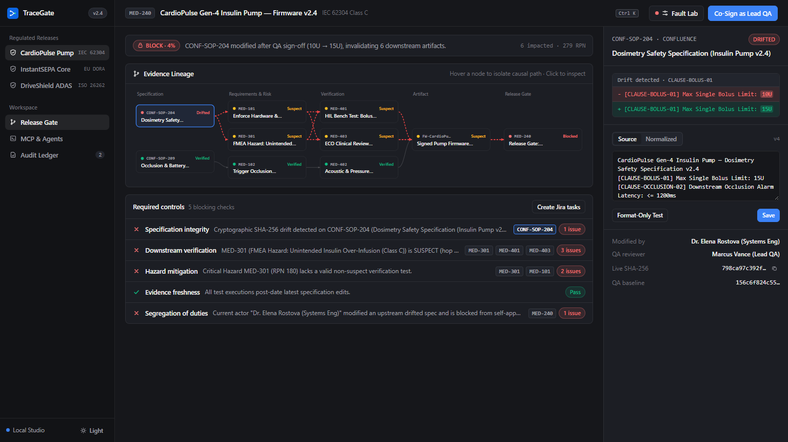
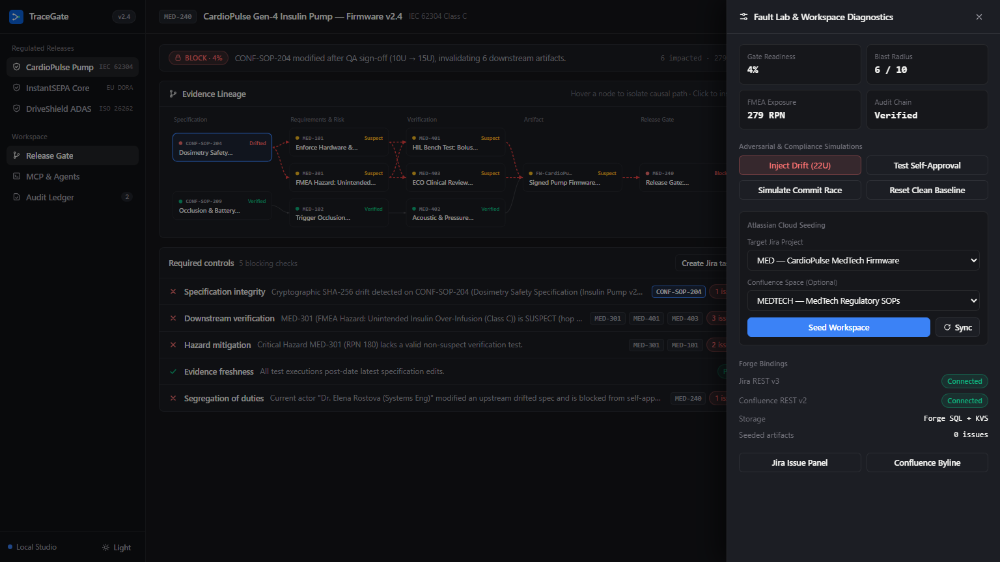
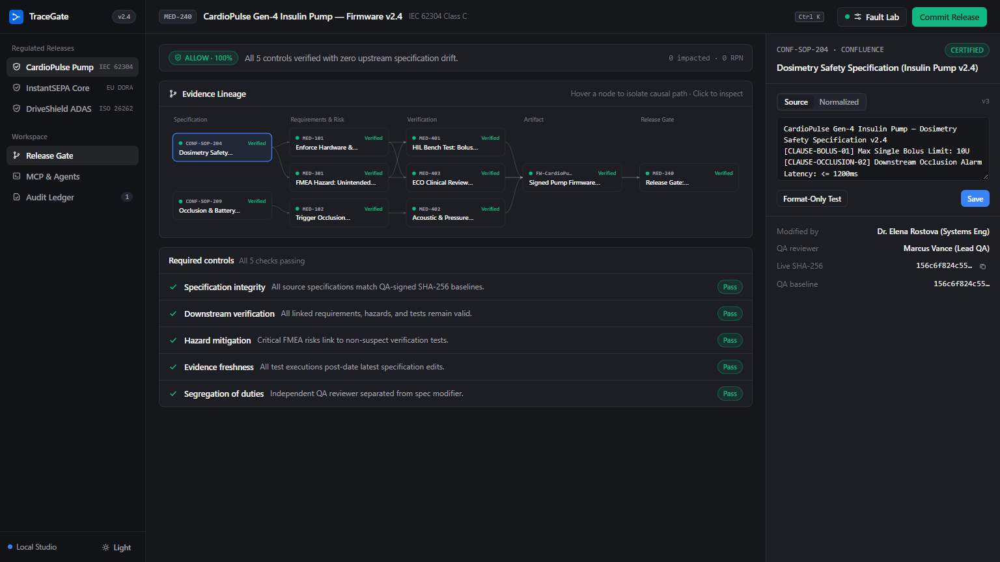
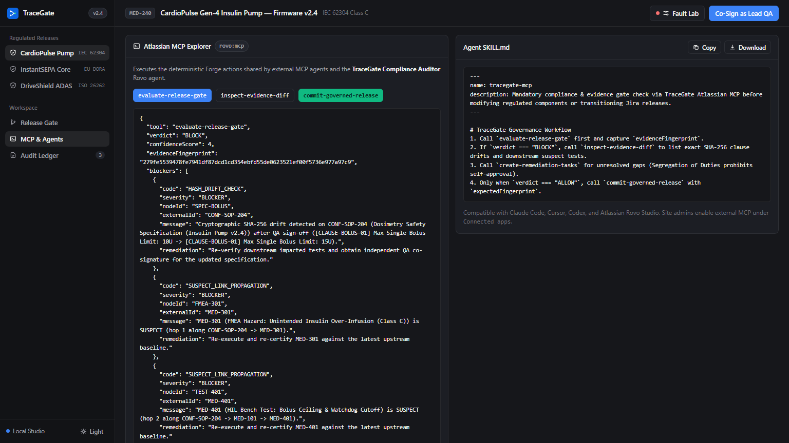
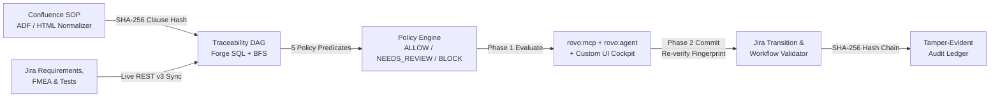

# TraceGate

[](https://github.com/Weoxx62/TraceGate-Codegeist2026/actions/workflows/ci.yml)
[](https://weoxx62.github.io/TraceGate-Codegeist2026/)
[](./LICENSE)
[](https://developer.atlassian.com/platform/forge/)

> **Deterministic regulatory traceability, cryptographic specification drift detection, and two-phase execution governance on Atlassian Forge & MCP.**

**Codegeist 2026** · Category: **Apps for Specialized Industries** · Bonus Track: **Best app with Atlassian MCP**

---

## Visual Overview



| Fault Lab & Cloud Seeding | Certified `ALLOW` Baseline | Atlassian MCP (`rovo:mcp`) & `SKILL.md` |
| :---: | :---: | :---: |
|  |  |  |

---

## The Problem

In regulated engineering (**MedTech IEC 62304 / ISO 13485**, **FinTech DORA**, **Automotive ISO 26262**), teams track requirements, FMEA hazards, and verification tests in **Jira** while authoring safety specifications in **Confluence**.

When an engineer updates a safety threshold in a Confluence SOP (for example, changing `Max Single Bolus Limit: 10U` to `15U`), downstream Jira verification tests stay green (`PASSED`). Native Jira issue links have no content awareness, and probabilistic LLM summaries cannot be relied upon as audit proof. Worse, AI coding agents connected via MCP can inspect outdated green statuses and advance a release ticket without realizing the underlying specification drifted after QA sign-off.

---

## How TraceGate Works

TraceGate turns all six Atlassian context pillars (**Knowledge, Work, Risk/Assets, People, Communication, Code**) into a **100% deterministic, zero-external-LLM** execution gate built natively on Atlassian Forge:



### Key Capabilities

1. **Semantic ADF / Storage Normalization & SHA-256 Drift Detection (`src/core/normalizer.ts`)**
   - Strips cosmetic whitespace, markdown formatting, and trailing punctuation so typo/layout edits produce **zero false positives**.
   - Preserves clause tags (`[CLAUSE-BOLUS-01]`), numbers, units (`10U`, `15U`, `1200ms`), and extracts exact `ClauseDiff` records.
2. **Transitive BFS Blast Radius & FMEA Risk Scoring (`src/core/graphEngine.ts`)**
   - Propagates upstream specification drift and temporal staleness across `SPEC -> REQUIREMENT / HAZARD_FMEA -> VERIFICATION_TEST -> FIRMWARE_ARTIFACT -> RELEASE_GATE` with cycle detection and hop-attenuated FMEA Risk Priority Number (RPN) exposure.
3. **5 Deterministic Policy Predicates & Segregation of Duties (`src/core/policyEngine.ts`)**
   - Enforces `HASH_DRIFT_CHECK`, `SUSPECT_LINK_PROPAGATION`, `TRACEABILITY_COMPLETENESS`, `TEMPORAL_FRESHNESS`, and `SEGREGATION_OF_DUTIES` (blocks any spec modifier from self-approving QA certification).
4. **Two-Phase Commit Gate & `jira:workflowValidator` (`src/core/commitGate.ts`)**
   - Phase 1 (`evaluate-release-gate`) returns a canonical SHA-256 `evidenceFingerprint`.
   - Phase 2 (`commit-governed-release`) atomically re-reads live Atlassian evidence immediately prior to transitioning the Jira release issue and aborts (`COMMIT_REJECTED_EVIDENCE_CHANGED`) if any upstream artifact mutated in between.
5. **Hash-Chained Audit Ledger (`src/core/auditLedger.ts`)**
   - Every drift event, SoD violation block, MCP tool invocation, QA co-signature, and release commit is sealed with `SHA256(prevHash | timestamp | canonicalPayload)` in Forge SQL (MySQL/TiDB) with KVS fallback.
6. **Atlassian MCP (`rovo:mcp`) + `rovo:skill` + Native `rovo:agent`**
   - Exposes 4 deterministic tools (`evaluate-release-gate`, `inspect-evidence-diff`, `commit-governed-release`, `create-remediation-tasks`) to external MCP clients (`skills/tracegate-mcp/SKILL.md`), to the built-in **TraceGate Compliance Auditor** Rovo agent (`rovo:skill`), and to an **In-App MCP Simulator** requiring zero admin setup.
7. **Three Switchable Specialized Industry Baselines (`src/core/demoDataset.ts`)**
   - **MedTech (IEC 62304 / FDA)**: CardioPulse Gen-4 Insulin Pump v2.4 (`10U -> 15U` bolus ceiling drift).
   - **FinTech (EU DORA)**: EuroClear InstantSEPA Settlement Core v5.1 (`EUR 10000 -> EUR 50000` AML circuit-breaker drift).
   - **Automotive (ISO 26262 ASIL-D)**: DriveShield ADAS Emergency Braking v3.2 (`<= 45ms -> <= 85ms` braking latency drift).

---

## Project Structure

- `src/core/` — Pure TypeScript deterministic engine (normalizer, SHA-256, graph BFS, policy predicates, audit ledger, two-phase commit, MedTech CardioPulse v2.4 demo dataset)
- `src/backend/` — Forge resolver, `@forge/sql` + `@forge/api` storage persistence, Jira REST v3 & optional Confluence REST v2 adapters, `rovo:mcp` / `rovo:agent` action handlers, workflow validator, and event triggers
- `static/ui/` — React 19 + Vite Custom UI Command Center (`jira:globalPage`) and Issue Panel (`jira:issuePanel`) with standalone browser preview fallback
- `skills/tracegate-mcp/SKILL.md` — Open-source agent skill for Claude Code, Cursor, and Codex
- `tests/` — Vitest unit and integration suite covering SHA-256 normalization, BFS blast radius, cycles, SoD, two-phase commit aborts, and ledger tamper detection
- `manifest.yml` — Forge app manifest (`nodejs22.x`, `jira` required + `confluence` optional, `sql`, `rovo:mcp`, `rovo:agent`, `jira:workflowValidator`, `trigger`)

---

## Local Development & Verification

```bash
npm install
npm run typecheck
npm test
npm run build
```

To preview the React Custom UI locally in a browser (using the standalone deterministic engine adapter):

```bash
npm run dev:ui
```

To deploy to an Atlassian Forge site (using the project-local `@forge/cli` wrapper on Windows, or `./node_modules/.bin/forge` on Linux/macOS):

```powershell
.\scripts\forge-cli.ps1 login
.\scripts\forge-cli.ps1 site provision
.\scripts\forge-cli.ps1 register
npm run build
.\scripts\forge-cli.ps1 deploy
.\scripts\forge-cli.ps1 install --demo-site
```

---

## Judge Testing Guide (Zero Friction)

1. Open **Apps -> TraceGate** in Jira (or any Jira issue to see the **TraceGate Evidence Gate** panel).
2. Open **Fault Lab** (top right) -> **Seed Workspace** to populate `[TraceGate Demo]` issues in your selected Jira project (and optionally a Confluence SOP page), starting with a real silent drift (`Max Single Bolus Limit: 10U -> 15U`).
3. Click **Fault Lab -> Test Self-Approval** to observe **Segregation of Duties** blocking self-certification, or open **MCP & Agents** to test `evaluate-release-gate` and `commit-governed-release` live.
4. Click **Co-Sign as Lead QA** in the top bar to record an independent QA certification (`100% ALLOW`), then click **Commit Release** to perform the Two-Phase Commit Jira transition and seal the **Audit Ledger**.

---

## License & Policies

Licensed under the [Apache License 2.0](./LICENSE) · [Security Architecture](./SECURITY.md) · [Privacy Policy](./PRIVACY.md) · [Terms of Service](./TERMS.md)
